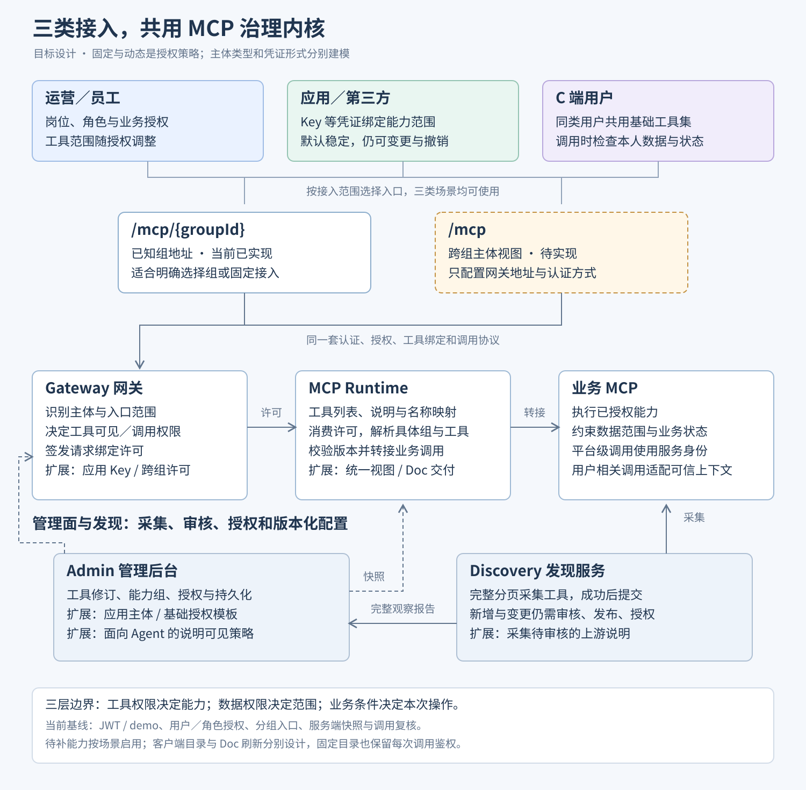

# 接入场景与能力视图设计

设计更新日期：2026-10-10。本文记录目标架构及其与当前实现的差异；标为“待实现”的入口、模型和适配器尚不能直接使用。四个启动器和已有工具生命周期继续保留。

## 1. 三类场景，共用治理内核

| 使用场景 | 授权主体与凭证 | 默认工具范围 | 变化来源 |
|---|---|---|---|
| 运营／公司员工 | 员工身份；企业登录后取得访问凭证 | 按岗位、角色及业务授权 | 岗位、职责及组织授权调整 |
| 应用／第三方 | 应用主体；Key 或其他应用凭证 | 应用绑定的能力组或能力套餐，默认稳定 | 合作范围、应用配置、授权修订或撤销 |
| C 端用户 | 消费者身份；产品登录或用户授权 | 同类用户共用基础工具集 | 产品版本、用户类型、会员权益及灰度策略 |

以上是默认使用策略，不是三个互斥认证协议。员工、应用和消费者是主体分类；Key、JWT 等是凭证形式；固定或动态是授权策略。Key 的权限可以调整和撤销，员工也可以长期使用固定工具集。变化频率不作为拆服务的依据。

“固定工具集”表示在同一产品／授权配置版本下结果稳定；客户端仍通过 `tools/list` 获取名称、说明和参数定义。固定配置也受工具发布、停用、修订和凭证有效性约束。

平台统一处理：可信身份映射 → 授权策略 → 当前可见工具 → 调用鉴权 → 业务执行。当前 Caller、Grant、CapabilityGroup 均带 clientType，三端业务 API 分开组织，网关据分组选择认证骨架。真实认证、Key 生命周期及模板配置待补。当前 ROLE 授权可给同类消费者复用相同已发布工具；待补的是专用接入样例、模板管理及业务数据范围适配，不是必须为每位消费者单独授权。

## 2. 工具权限、数据权限和业务条件分层

| 层次 | 回答的问题 | 主要责任方 | 是否应改变 Tool List |
|---|---|---|---|
| 工具权限 | 这个主体能否使用这项能力 | 平台授权策略／企业权限适配器 | 权限范围改变时改变 |
| 数据权限 | 本次能访问哪些订单、门店或账号 | 资源授权适配器及业务服务 | 单条数据归属差异不必改变目录 |
| 业务条件 | 该订单当前是否可取消、退款或修改 | 业务服务 | 单条业务状态变化不必改变目录 |

例如，同类 C 端用户共用“查订单、取消订单、申请退款”及同一份使用说明。订单归属、退款期限和当前状态在实际调用时判断，不为每个订单生成一套工具目录。需要产品能力差异时，再由用户类型等策略控制工具范围。

现有 `ResourceAccessChecker` 是带调用者的前置布尔判断接口，默认拒绝受保护资源；它不会自动注入查询条件、过滤返回数据或替代业务状态检查。资源判断与业务提交之间的状态变化仍由业务服务在执行时校验。

## 3. 两种入口并列，按接入目标选择

| 入口 | 适用条件 | 客户端预先知道什么 | 实现状态 |
|---|---|---|---|
| `/mcp/{groupId}` | 接入方已明确选择能力组，或应用绑定已知固定组 | 分组地址及认证方式 | 已实现 |
| `/mcp` | 接入方只配置一个地址，需要获得主体在该入口范围内的跨组能力 | 网关地址及认证方式，不必知道组 ID | 待实现 |

分组入口对固定能力接入是完整方案，不因没有跨组自动发现就判为缺陷。统一入口也可服务固定工具集，其返回内容不必因用户不同而变化；两种入口都复用同一治理内核。

统一入口的工具视图为：入口允许范围 ∩ 主体有效授权 ∩ 当前已发布且来源可用的工具绑定。MCP `tools/list` 返回标准工具数组；能力组是平台内部组织结构，不要求客户端支持自定义的分组数组。可见工具为空时返回空列表，不放宽权限补齐目录。

客户端无需根据文档自行拼接后端 URL；Runtime 通过已登记绑定路由。认证如何取得凭证由相应身份接入方案定义，不假设普通 MCP 客户端能自动完成任意企业登录。

## 4. 统一入口的工具绑定与执行许可

组内别名不能直接无约束合并。统一入口应建立稳定的对外名称，映射至明确的 `groupId + groupAlias + toolId`，并在执行时校验工具当前修订、来源和授权。命名可以带语义前缀，但必须验证最终名称长度、字符及冲突，不能仅靠字符串拼接保证唯一性。

同一工具在不同组复用时保留组作用域。默认按绑定暴露，不能仅按 `toolId` 去重后混用其他组的授权。后续如需合并展示，必须先定义可验证的授权与路由等价条件。

当前 `InvocationPermit` 和 Runtime 路径都绑定单个组。统一入口需要分开发现许可与执行许可：发现许可表达该主体获准查看的跨组绑定范围；调用许可绑定解析后的具体组、工具及修订。继续保留组织、请求内容、快照版本、有效期及防重放校验，控制许可体积。Runtime 消费网关授权结果，不复制另一套用户授权策略。

网关与 Runtime 从同一版本目录解释对外名称；旧名称不得静默重定向到另一业务工具。缓存客户端提交的调用仍依据当前绑定和权限检查，发现结果不充当后续调用凭证。

Key 的能力套餐可编译为显式授权模板，但组内新增工具、变更修订不自动继承旧授权。加入组与获得权限仍是两件事。

## 5. 能力说明与调用权限分别管理

一组工具可以共用固定 Doc，说明业务概念、能力边界、参数约定及工具配合方式。部分授权不会使整份 Doc 必然失效；必须工具缺失时相应流程不可完成，独立查询和可选分支仍可使用。

说明的可见性与工具的可调用性分别判定：

| 说明内容 | 处理规则 |
|---|---|
| 已批准向该受众公开的能力概述或固定手册 | 可以保留完整业务说明，并明确实际调用以当前工具列表及调用鉴权为准 |
| 当前可执行能力摘要 | 由实际可见工具和已声明的依赖生成，不把完整手册当作已获全部权限的承诺 |
| 连能力存在、工具名称或流程都需保密的说明 | 按文档或受控章节权限过滤；当前用户不能因读 Doc 得知受保护内容 |
| 管理员备注、后端配置及内部凭据 | 不向 Agent 返回 |

不要求为每种权限组合人工维护整份手册，也不让通用治理层从自由文本猜测业务依赖。需要自动展示“可执行流程”时，由业务方显式登记必需工具及可选步骤。文档模板引用平台工具标识，生成时解析为实际对外名称；任意自由文本中的名称不能通过盲目替换保证正确。

交付分三层：单工具 `description` 和 schema 包含调用必需信息；`initialize.instructions` 提供简短公共规则和相关能力组摘要；长手册通过受控文档查询工具按需读取（待实现）。具体 MCP 客户端是否把 instructions 注入模型上下文，需要兼容性验证，不能把关键执行约束只写在说明里。

当前 `CapabilityGroup.description` 作为管理说明保存，尚未返回给 Agent；当前 instructions 只是组标题与可见工具名。目标实现需区分管理备注与面向 Agent 的说明，旧管理说明默认保持内部，不因升级自动公开。文档公开模式需显式配置；没有配置时保留现有保守行为。

上游 `initialize` 的 instructions 当前未被连接器保留。后续采集后作为待审核说明元数据，由业务维护者组织成能力组 Doc，处理跨服务规则冲突和别名引用；不能无条件拼接所有上游文本。当前工具级 description 原样转发，其中的跨工具引用也需纳入检查。

## 6. 服务端权限生效与客户端发现更新分别定义

| 变化 | 服务端必须做什么 | 客户端视图如何更新 |
|---|---|---|
| 工具集稳定、无会话内自动更新要求 | 每次调用仍校验凭证、授权、工具状态与资源范围 | 初次连接、重新连接或显式刷新获取定义 |
| 新增／撤销权限、工具发布／停用／定义变化 | 在约定传播窗口内应用策略；旧列表不能授权调用 | 要求自动更新的接入使用对应协议版本的列表变化通知，客户端重新拉取；不支持时明确重连／主动刷新方式 |
| 只有订单状态或单条数据权限改变 | 按可信数据检查当次调用和业务状态 | 不必刷新整份工具目录 |
| 组 Doc 或使用规则改变 | 应用当前文档可见策略与版本 | 文档重新读取；初始化说明的刷新需明确重连或客户端支持，不能把工具列表通知视为 instructions 自动更新 |

当前网关／Runtime 默认每 2 秒刷新快照，租约默认 15 秒，存在传播窗口；快照租约过期时拒绝受保护请求。当前没有工具列表变化通知或 SSE 通道，`listChanged=false`，客户端必须主动获取列表。通知能力按所支持的协议版本实现，不能只把标志改成 true。

目录、说明及绑定缓存必须隔离组织、身份来源、授权主体和入口作用域，并与适用的授权／目录／文档版本关联。只有证明视图等价时才共享缓存；不因 C 端默认工具相同就共享用户数据。当前内存配置快照版本不等于客户端已更新版本。

## 7. 业务端执行上下文按能力需求传递

平台级操作使用应用或平台身份即可。涉及“我的订单”“我负责的门店”等用户相关操作时，必须由受信的服务端链路提供业务用户映射或数据范围，不依赖 Agent 自填 `userId` 认定当前身份。

Caller 经签名许可到 Runtime，再通过 `McpConnector.invoke(service, tool, arguments, caller)` 传给连接器；消费者／员工写入 X-AOMI-AUTH-UID，应用写入 x-aomi-third-appid，并附 X-Mcp-Client-Type。上游专用服务凭据独立配置，发现不带终端身份。外部 Bridge 须验证平台来源，再接通通用注解和 Feign，当前项目不代替此联调。

未来多主体委托可在现有显式 Caller 传递之上扩展发起应用与终端用户的联合上下文；本次只传当前主体的业务 ID 和类型。业务数据范围及具体账号映射仍由企业适配器负责。业务 MCP 必须验证平台签发、限定受众和有效期的凭证／上下文，或接受等价的受控服务端范围注入。用户入口 Token 和网关到 Runtime 的内部许可都不直接转发给业务服务。

前置资源检查与业务端范围执行使用一致定义。列表查询缺少具体资源 ID 时，不能仅用一次布尔判断代替查询范围约束。具体业务映射与服务端范围执行由企业适配器实现，不强迫所有固定 Key 工具携带自然人身份。

## 8. 四个启动器的目标职责

| 启动器 | 本次明确的职责 |
|---|---|
| Gateway | 解析用户／应用主体；校验入口范围；决定工具授权；签发请求绑定许可 |
| Runtime | 基于已授权范围生成统一或单组工具视图、说明及名称映射；执行协议交互并转接调用 |
| Admin | 管理服务、工具修订、能力组、授权模板、主体绑定及说明可见策略 |
| Discovery | 完整采集业务 MCP 工具；扩展采集说明元数据；采集不等于发布或授权 |

当前已有三端认证骨架、类型隔离的主体／角色授权、分组入口、快照、调用复核和业务身份头传递。真实认证与外部 Bridge 联调见 [身份 TODO](IDENTITY.md)，其他目标继续在原有模块演进。

## 9. 实现差异与验收

| 项目 | 当前状态 | 对应待办 |
|---|---|---|
| 三端认证骨架、主体／角色类型隔离 | 已实现框架；真实校验方法未实现 | F08、F10 继续扩展 |
| Key 验证及轮换、C 端 Redis、员工身份源与模板配置 | 待实现；已有类型与方法骨架 | F08、F10 |
| 已知组 `/mcp/{groupId}` | 已实现 | 保留兼容 |
| 统一 `/mcp` 与跨组绑定映射／许可 | 待实现 | F28 |
| 完整组说明、受控公开策略与上游说明采集 | 待实现；当前仅动态工具名摘要 | F12、F14 |
| 客户端工具变化通知、文档刷新契约 | 待实现；当前主动刷新 | F15、F18 |
| 上游业务身份传递 | 已实现 Caller 到请求头；Bridge 来源验证、注解／Feign 联调待完成 | F10、F14 |

验收场景在 [验证说明](VALIDATION.md) 中单列为待实现，不计入现有测试通过范围；实现清单见 [TODO](../TODO.md)。

## 10. 外部参考

以下资料用于验证模式，不把第三方产品的具体实现当成本框架的既成能力：

- [MCP 工具协议](https://modelcontextprotocol.io/specification/2025-11-25/server/tools)：工具列表、调用和列表变化通知。
- [MCP Server Instructions](https://blog.modelcontextprotocol.io/posts/2025-11-03-using-server-instructions/)：组间／工具间关系说明及客户端使用差异。
- [Shopify Customer Accounts MCP](https://shopify.dev/docs/apps/build/customer-accounts-mcp)：客户账户及订单工具与客户身份授权。
- [Shopify Customer Account API](https://shopify.dev/docs/api/customer/latest)：访问买家自身数据。
- [Stripe MCP](https://docs.stripe.com/mcp)：用户 OAuth 与应用 Key 接入模式。
