# 架构与 UML 图集

以下为可直接查看的 SVG 图片，可下载后放大。图示对应当前实现，虚线刷新表示有界最终一致性。

## 总体架构

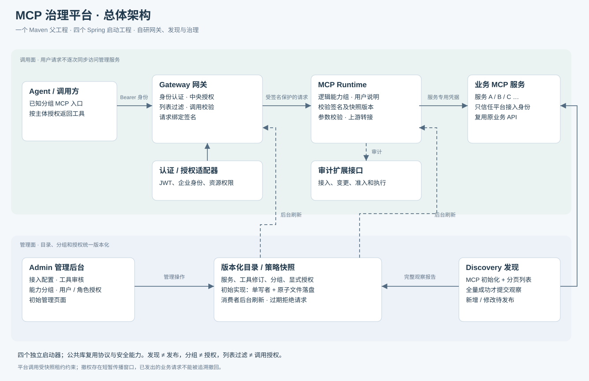

## UML 领域模型

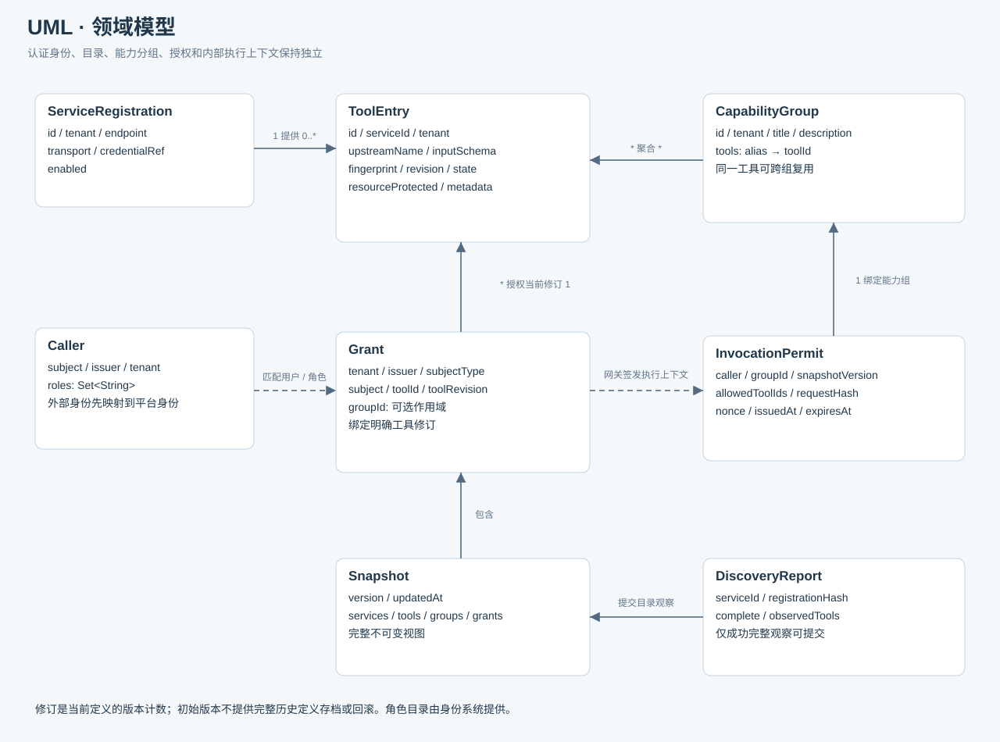

## 工具生命周期

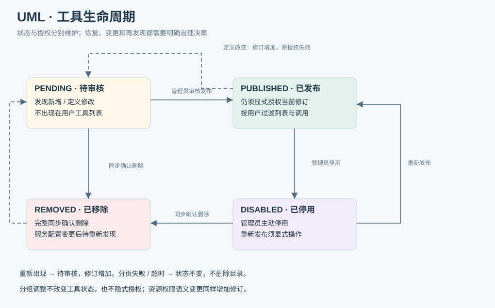

## 01 · 服务接入

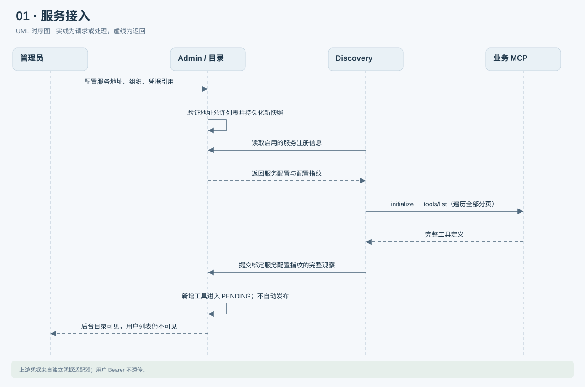

## 02 · 服务代码更新与目录同步

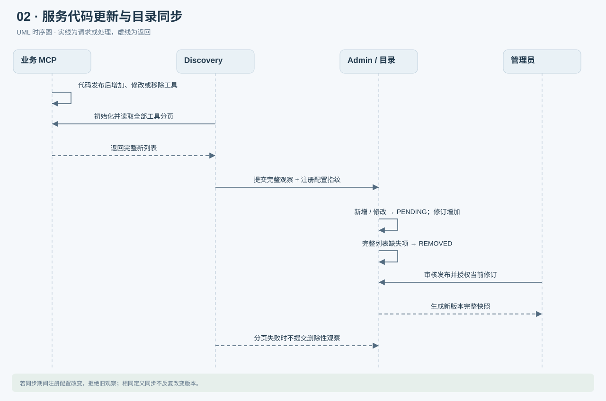

## 03 · 跨服务能力分组

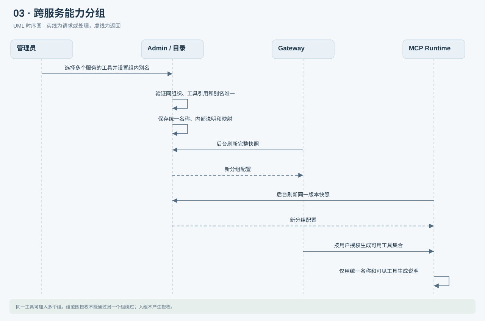

## 04 · 授权与撤权

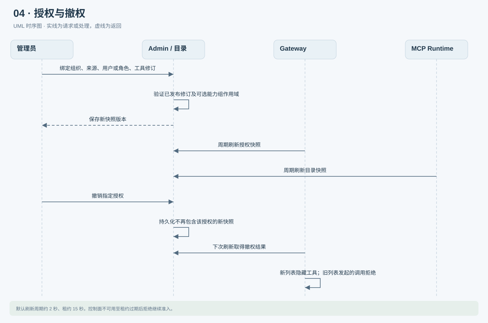

## 05 · 用户连接与发现能力

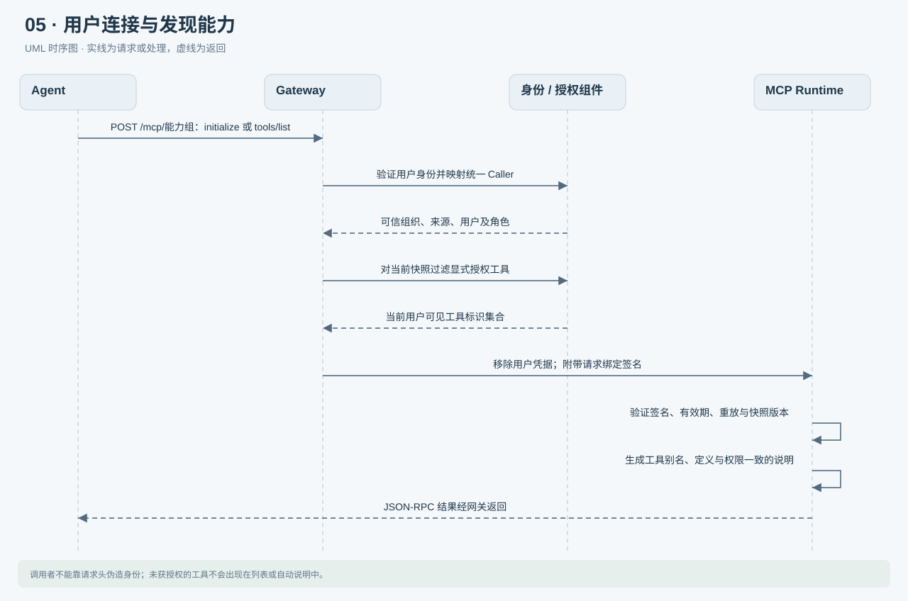

## 06 · 正常工具调用

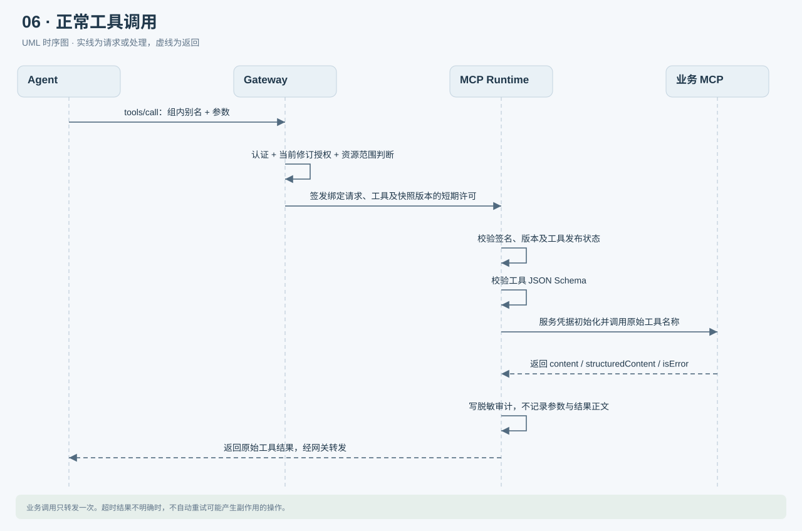

## 07 · 越权与绕过拦截

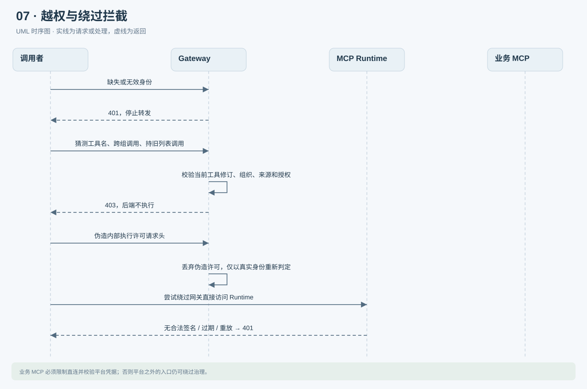

## 08 · 异常与变更生效

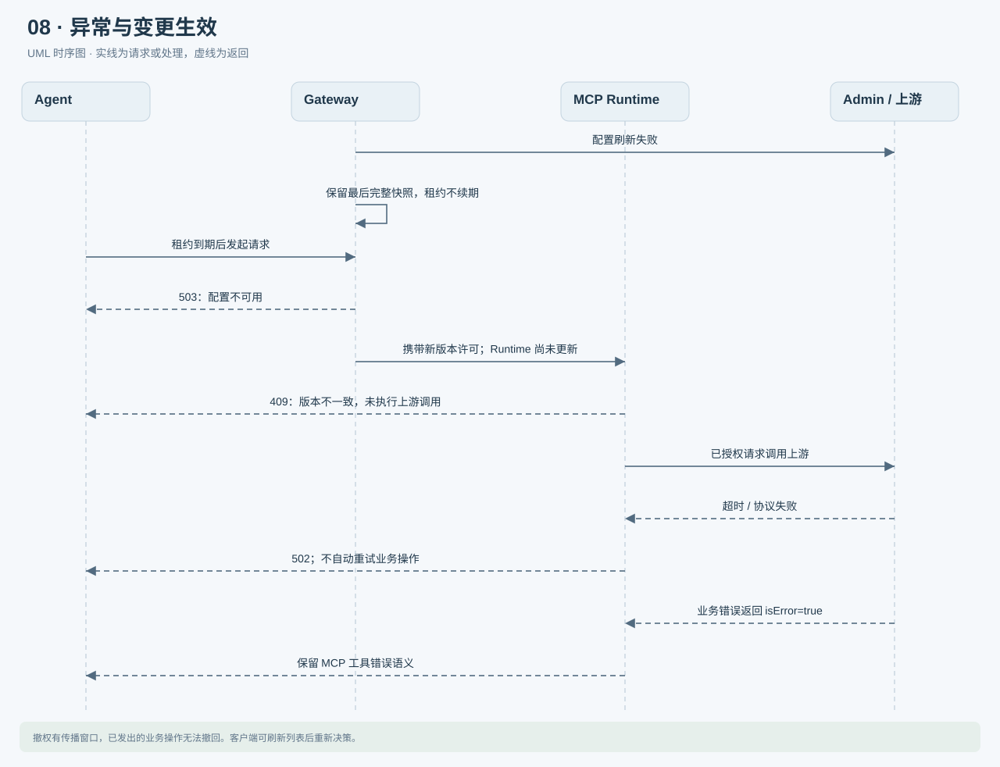
